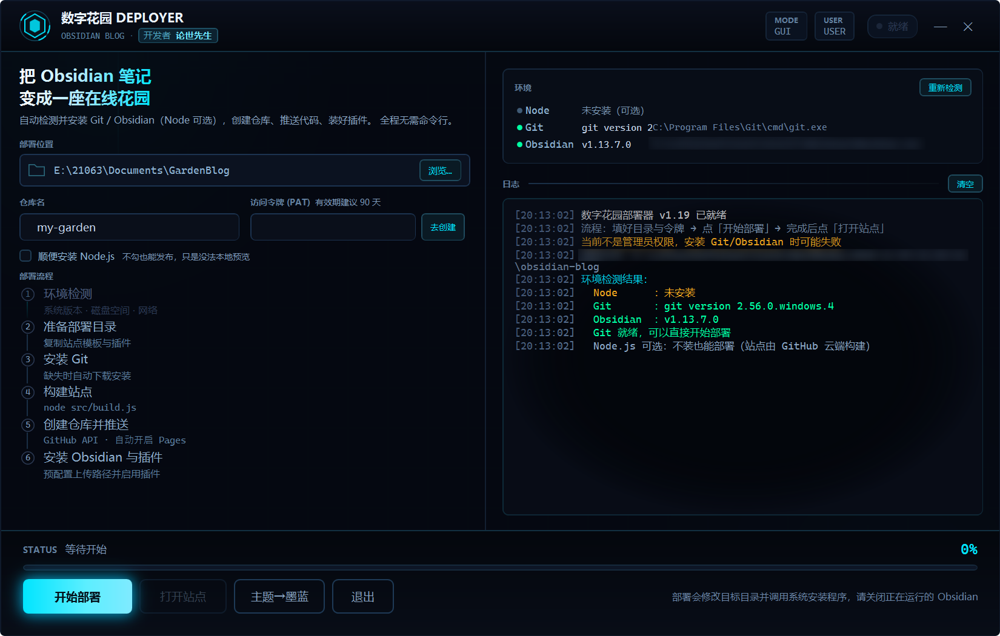

# 数字花园 · Obsidian 博客

> 把 Obsidian 笔记变成一座在线花园 —— 双链、反向链接、全文搜索、关系图，一键部署到 GitHub Pages。

[](https://github.com/lunshi2022/obsidian-blog/releases)
[](https://github.com/lunshi2022/obsidian-blog/releases)
[](https://github.com/lunshi2022/obsidian-blog/actions/workflows/release.yml)
[](#-license)

[下载部署器](https://github.com/lunshi2022/obsidian-blog/releases) ·
[配套插件 Blog Uploader](https://github.com/lunshi2022/blog-uploader) ·
[问题反馈](https://github.com/lunshi2022/obsidian-blog/issues)

**零依赖** —— 构建脚本只用 Node 内置模块，不需要 `npm install`；部署器是单个独立 exe，无需安装任何运行时。

## 📸 界面预览

**Windows 一键部署器** —— 填三个框，剩下全自动：



## ✨ 功能特性

- **一键部署**：双击 exe，填三个框（目录、仓库名、令牌），剩下全自动 —— 装 Git/Obsidian、创建 GitHub 仓库、推送代码、开启 Pages、装好插件
- **数字花园体验**：`[[双链]]`、反向链接、全文搜索、关系图，Markdown 原生书写
- **一键上博**：Obsidian 里点 ↑ 图标，笔记 + 附件自动复制、构建、推送，几分钟后网站自动更新
- **本地预览**：不用开终端，Obsidian 命令面板一键起服务（Node 可选，没装由 GitHub 云端构建）
- **自动发版**：推一个版本标签，云端自动编译部署器并发布到 Releases
- **国内友好**：Git / Node / Obsidian 全部走国内镜像下载，GitHub API 备用

## 🚀 快速开始

**方式一：一键部署器（推荐）**

1. 到 [Releases](https://github.com/lunshi2022/obsidian-blog/releases) 下载 `GardenDeployer.exe`
2. 双击运行，准备一个 [GitHub 访问令牌](https://github.com/settings/tokens/new?scopes=repo,workflow)（页面已预填好权限）
3. 填好部署目录和仓库名，点「开始部署」，喝口水等它跑完

**方式二：手动部署**

1. 在 GitHub 新建一个**公开**仓库，比如 `garden`
2. 克隆或下载本项目，推送到你的仓库：

   ```bash
   git init
   git add -A
   git commit -m "init: 数字花园"
   git branch -M main
   git remote add origin https://github.com/<你的用户名>/garden.git
   git push -u origin main
   ```

3. 打开仓库 **Settings → Pages → Source**，选择 **GitHub Actions**
4. 站点地址：`https://<你的用户名>.github.io/garden/`，记得在 `site.config.json` 里把 `siteUrl` 填成这个地址

## 📝 怎么写

把 `.md` 文件放进 `content/` 即可，子文件夹会变成侧边栏目录树。模板自带的 `content/使用指南/` 收录了示例文档，看完可以直接删掉，根目录只留 `index.md`（首页）和你自己的笔记。

| 语法 | 写法 |
| --- | --- |
| 双链 | `[[笔记名]]`、`[[笔记名\|别名]]`、`[[笔记名#小标题]]` |
| 嵌入 | `![[图片.png]]`、`![[笔记名]]`（渲染为卡片）、音视频、PDF |
| 标签 | frontmatter `tags:` 或正文 `#标签`，自动生成标签页 |
| Callout | `> [!tip] 标题`，`[!tip]-` 默认折叠 |
| 其他 | 表格、任务列表、`==高亮==`、`~~删除线~~`、数学公式（自动加载 KaTeX） |

frontmatter 支持的字段：

```yaml
---
title: 自定义标题        # 默认取文件名或第一个一级标题
date: 2026-01-01        # 默认取文件修改时间
tags: [a, b]
aliases: [别名]         # 双链可以用别名指向这篇
description: 摘要       # 用于搜索与卡片
slug: custom-url        # 自定义输出路径（默认沿用目录结构）
draft: true             # true 则不发布
---
```

指向不存在的 `[[笔记]]` 会渲染成灰色虚线链接 —— 这是待写清单，不是错误。`content/index.md` 会作为首页开场白。

## 🧩 配套插件：Blog Uploader

[`blog-uploader/`](https://github.com/lunshi2022/blog-uploader) 是一个 Obsidian 社区风格插件，装在笔记库里：

> 复制笔记到博客仓库（保持库内目录结构）→ 复制它引用的全部附件 → 自动构建 → git 提交推送

- 左侧边栏 ↑ 图标 / 文件右键「上传到博客」/ 命令面板
- 「修改后再上传一次」就是更新（同名覆盖）；不想发布的笔记写 `draft: true`
- 设置里可分别开关「自动构建」和「自动推送」，想攒一批再发就关掉推送

安装与令牌配置见[插件仓库 README](https://github.com/lunshi2022/blog-uploader)。

## 🛠 Windows 一键部署器（源码）

`deployer/` 里是 C# 编写的 WPF 部署器，编译成单个独立 exe（约 250 KB，无任何运行时依赖）：

```
双击 deployer\build.bat  →  生成 GardenDeployer.exe
```

- 编译器用 Windows 自带的 .NET Framework，不需要装任何东西
- 博客模板通过 payload.zip 打进 exe，用户只下载一个文件
- 改完代码推一个 `vX.Y` 标签，GitHub Actions 自动编译并发布到 Release
- 首次拿到 exe 建议先跑 `GardenDeployer.exe --selftest` 自检，详见 [deployer/README.md](deployer/README.md)

> 本机**不需要 Node**：站点由 GitHub Actions 在推送后构建。卸掉 Git / Obsidian 也不会影响笔记和已发布的网站，但卸掉 **Git 就无法再推送**。

## 🎨 主题与自定义

**三套内置配色**，改 `site.config.json` 里的 `theme` 字段即可切换（改完提交推送，Actions 自动重建）：

| theme 值 | 风格 | 主色 |
| --- | --- | --- |
| `garden`（默认） | 青绿 · 纸感 | `#17685a` |
| `ink` | 墨蓝 · 清冷 | `#2f5fca` |
| `dawn` | 暖阳 · 奶油 | `#c2622a` |

每个主题都自带深浅两套色值，右上角 ◐ 的深色模式切换照常可用。

**想再进一步自定义**（改主色、字体、圆角）：

1. **只调颜色**：编辑 `assets/style.css` 顶部的 CSS 变量（`--bg`、`--accent` 等），改几个十六进制值就是一套新气质
2. **加一套新主题**：在 `src/build.js` 的 `THEMES` 表里加一组变量（浅色 + 深色两份），然后就能用新的 `theme` 名字
3. **改布局/字体**：都在 `assets/style.css`，`--font-sans`、`--radius` 等变量各管一摊

深色模式自动跟随系统，右上角 ◐ 可手动切换并记住选择。

> **会让 exe 变大吗？** 不会。每个主题只是一小段 CSS 变量覆盖（约 400 字节，压缩后不到 200 字节），加十套主题 exe 也只长几 KB。真正占体积的是运行时，而运行时是借 Windows 自带的。

## 🪪 站点名称、图标与首页文案

站名、左上角标志、副标题、页脚署名——全部在 `site.config.json` 里，不用碰代码：

| 字段 | 控制哪里 | 示例 |
| --- | --- | --- |
| `title` | **左上角品牌名**、首页大标题、浏览器标签页标题 | `"论世先生的花园"` |
| `mark` | 左上角图标方框里的**字符**（任意一个字符或 emoji） | `"◈"`、`"🌱"`、`"墨"` |
| `description` | 首页大标题下的**副标题**，也用于搜索摘要 | `"种一棵树最好的时间是十年前"` |
| `author` | **页脚版权署名** | `"论世先生"` |

```json
{
  "title": "论世先生的花园",
  "mark": "墨",
  "description": "读书、写字、种一棵自己的树。",
  "author": "论世先生"
}
```

改完保存 → 推送（Obsidian 里随便点一次「上传博客」即可）→ 几分钟后全站生效。

另外两处：

- **浏览器标签页的小图标**：替换 `assets/favicon.svg`（任意 SVG 图标）
- **首页开场白**（大标题、副标题下面那段正文）：编辑 `content/index.md`

## ❓ 常见问题

- **推送后 Pages 没反应**：检查 Settings → Pages 的 Source 是否选了 GitHub Actions，以及 Actions 页面的运行日志；站点构建通常需要几分钟
- **链接里出现中文/百分号**：正常，文件名原样成为 URL，GitHub Pages 完整支持 UTF-8 路径
- **数学公式不渲染**：KaTeX 从 CDN 加载，需要联网；离线时公式按原文显示
- **想绑自定义域名**：在仓库根目录加 `CNAME` 文件（内容是域名），并在 `site.config.json` 的 `siteUrl` 里同步填写
- **卸载与恢复**：笔记是普通 `.md` 文件、网站托管在 GitHub 上，卸掉 Git/Obsidian 都不影响已有内容；详见 [deployer/README.md 的「卸载与恢复」](deployer/README.md#卸载与恢复)

## 🪜 开发踩坑记录（实战沉淀）

上线过程中真实撞过的坑，改同类代码前先看这里：

| 坑 | 现象 | 根因与修法 |
| --- | --- | --- |
| **令牌不能入库（GH013）** | 推送被 GitHub 拒绝：`Repository rule violations found` | 插件把 GitHub 令牌存在 `.obsidian/plugins/blog-uploader/data.json`，`git add -A` 会把它收进提交，GitHub 秘密扫描（push protection）直接拦截。`.gitignore` 必须排除**整个 `.obsidian/`**，不是只排除 workspace.json |
| **git 报错只显示尾巴** | 提示永远是一句没用的 `failed to push some refs` | git 推送失败时最后一行固定是这句通用结尾，真实原因（认证失败/非快进/权限不足）在前面的 `remote:` / `fatal:` / `! [rejected]` 行里。解析 stderr 要按行找关键行，不能取 `.pop()` |
| **GCM 弹窗卡死上传** | 推送时弹出「选择账户」页面卡住 | 凭据管理器残留 OAuth 凭据 + 子进程无法交互。插件/部署器都用**令牌内嵌 URL** 推送：`https://x-access-token:<PAT>@github.com/owner/repo.git`，彻底绕开 Git Credential Manager |
| **无新改动就不推送** | 重试推送时提示「内容没有变化」然后直接返回 | 「没有新改动」≠「没有未推送的提交」。正确的流程是：无改动时跳过 commit 但**继续执行 push**，让积压的提交补推上去 |
| **Process 读输出死锁** | 部署器调用 git 时卡死 | 先 `ReadToEnd()` 再写 stdin 会互锁。正确顺序：先写完 stdin 关闭，再异步读输出，且必须带超时（`WaitForExit(timeout)`） |
| **中文请求体乱码** | GitHub API 返回 HTTP 400 创建仓库失败 | `WebClient` 默认用系统 ANSI（GBK）编码发送。上传前设 `wc.Encoding = new UTF8Encoding(false)`，请求体才是合法 UTF-8 |
| **CSS 片段隐藏不彻底** | 文件树里文件夹标题没了但文件还悬着 | Obsidian 新版 DOM 中文件夹是一个整体容器。要用 `:has()` 隐藏整个容器：`.nav-folder:has(> .nav-folder-title[data-path="src"]) { display: none }` |
| **appearance.json 被覆盖** | 部署器写入的 CSS 片段启用状态莫名消失 | Obsidian 运行期间会回写 `.obsidian/appearance.json`。写入配置要在 Obsidian 关闭时进行，或引导用户在 设置→外观→CSS片段 手动开启 |
| **沙箱/CI 环境无 csc** | 部署器改完无法自动验证 | C# 只能静态核对，用户本机跑 `build.bat` 才是真编译；插件 `main.js` 可以 `node --check` 验证语法 |
| **改完插件没生效** | 修了 bug 现象依旧 | Obsidian 不会热加载插件代码。每次更新 main.js 后必须：设置→第三方插件→把 Blog Uploader 关掉再打开（或重启 Obsidian） |

## 📁 目录结构

```
├── blog-uploader/      # Obsidian 插件（一键上传当前笔记）
├── deployer/           # Windows 一键部署器（GUI，C# 源码）
├── content/            # 你的 Obsidian 笔记（.md 和附件）
├── src/
│   ├── build.js        # 构建入口
│   └── lib/
│       ├── markdown.js # Markdown 解析器
│       ├── obsidian.js # frontmatter / 双链 / 标签
│       └── templates.js# 页面模板
├── assets/             # 样式与前端脚本（会被复制进产物）
├── site/               # 构建产物（gitignore）
└── .github/workflows/  # Pages 部署 + Release 自动发版
```

## 📄 License

MIT © [论世先生](https://github.com/lunshi2022)
